<div align="center">

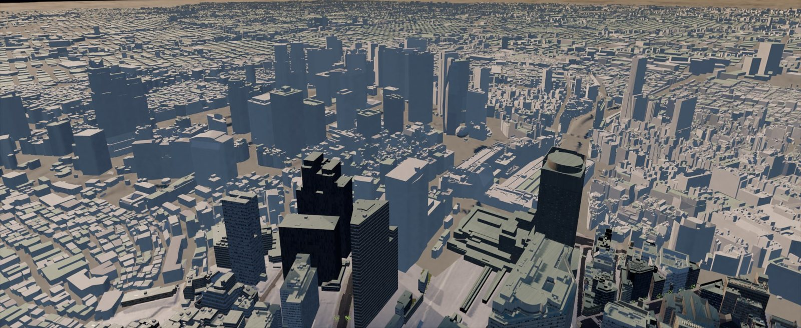

# TOKYO SANPO · 도쿄 산보

**실측 공간데이터로 다시 만든 도쿄를 걷고, 타고, 날아 보는 브라우저 오픈월드 탐방 게임**

전투도 레이스도 점수도 없습니다. 시부야 스크램블 교차로에서 하라주쿠, 신주쿠 초고층가까지 — 그냥 산책하세요.

### [▶ 지금 플레이 — earthaimap.com](https://earthaimap.com)

[](https://github.com/kolom1234/tokyoOpenWorld/actions/workflows/ci.yml)
[](https://github.com/kolom1234/tokyoOpenWorld/actions/workflows/deploy.yml)
[](https://earthaimap.com)
[](LICENSE)
[](docs/07-rendering.md)
[](docs/adr/0011-node-22-baseline.md)

[English](#english-summary) · [주요 기능](#주요-기능) · [스크린샷](#스크린샷) · [아키텍처](#아키텍처) · [데이터 출처](#데이터-출처와-라이선스) · [빠른 시작](#빠른-시작) · [문서](#문서-지도) · [보안](#보안과-비용-안전장치)

</div>

---

## English summary

**TOKYO SANPO** ("a stroll in Tokyo") is a calm, browser-based open-world exploration game set in a virtual Tokyo rebuilt from real open geospatial data — Japan's MLIT **Project PLATEAU** 3D city models, **GSI** elevation data, **OpenStreetMap**, and other public datasets. Walk the Shibuya Scramble Crossing, ride the Yamanote Line to Harajuku and Shinjuku, drive a car-share sedan, cycle, or fly a free camera over the skyline. There is no combat, racing, or scoring.

- **Play now:** <https://earthaimap.com> (desktop browser; WebGPU first, automatic WebGL2 fallback)
- **MVP area:** Shibuya – Harajuku – Shinjuku, about 3.6 × 5.4 km (294 cells of 256 m), with all 23 special wards shown as a low-detail skyline
- **Stack:** three.js `WebGPURenderer` + TSL, Jolt Physics (Web Worker, WASM), Preact UI, TypeScript monorepo, Cloudflare Workers + R2
- **UI languages:** Korean, Japanese, English
- **Code license:** MIT. Data and assets keep their own licenses — see [Data sources](#데이터-출처와-라이선스) and [`content/ATTRIBUTION.json`](content/ATTRIBUTION.json).

The project documentation is written in Korean. Start with [`CLAUDE.md`](CLAUDE.md) (project rules and doc map) and [`docs/01-architecture.md`](docs/01-architecture.md).

---

## 한눈에 보기

| | |
|---|---|
| **장르** | 실측 데이터 기반 도쿄 산책·탐방 시뮬레이터 (전투·레이스·경쟁 없음 — [비전](docs/00-vision.md)) |
| **플레이** | <https://earthaimap.com> — 2026-10-19 공개 (M11 Hardening & Beta 완료) |
| **구역(MVP)** | 시부야역·스크램블 교차로 ↔ 하라주쿠·오모테산도·요요기공원 ↔ 신주쿠역·서신주쿠·도청 — 약 3.6 × 5.4 km, 256 m 셀 294개(≈ 19.3 km²) |
| **원경** | 도쿄 23구 전역을 HLOD 스카이라인으로 표시 (PLATEAU 2020년도판, 건물 176.8만 동) |
| **플랫폼** | 데스크톱 브라우저. WebGPU 우선, 미지원 시 WebGL2 자동 폴백. 모바일 최적화는 비목표 |
| **언어** | 한국어 · 日本語 · English |
| **배포** | Cloudflare Workers(Static Assets) + R2 + KV, GitHub Actions(staging 자동 → production 수동 승인) |

---

## 주요 기능

**장소의 정확성 — "데이터가 없는 디테일만 창작한다"**
- PLATEAU 3D 도시모델의 건물(LOD2, 텍스처)·도로·교량·도시설비를 셀 단위로 빌드하고, 국토지리원 1 m DEM으로 실제 고저차를 재현합니다.
- OpenStreetMap에서 차선·일방통행·제한속도·신호·철도 선로·가로수·공원을 가져와 도로와 거리를 채웁니다.
- 랜드마크 7곳(시부야 스크램블 스퀘어, 하치코 광장, 스크램블 교차로 대형 비전, 요요기 국립경기장, 메이지 신궁, 도쿄도청, 신주쿠역 서쪽 출구)은 PLATEAU 형상을 재사용한 오버라이드로 다듬었습니다.

**걷고, 타고, 날기 — 다섯 가지 이동 모드** ([09-traversal](docs/09-traversal.md))
- **도보** 1인칭/3인칭, 계단·연석·육교, 신호 대기와 스크램블 대각 횡단.
- **전철** 개찰구 → 승강장 → 야마노테선 탑승(시부야–하라주쿠–요요기–신주쿠), 서서 타기·전면 전망·빨리 감기. 사이쿄선·쇼난신주쿠라인은 병행 운행(시각 전용).
- **운전** 우핸들·좌측통행 승용차(카셰어 거점), 교통 흐름 속 드라이브, 보행자 앞 자동 비상 제동(AEB).
- **자전거** 공유자전거 독에서 빌려 골목 탐방.
- **자유 비행** 어디서든 드론 카메라로 전환해 도시를 조망.

**도시의 생활감** ([10-simulation](docs/10-simulation.md))
- DetourCrowd 기반 군중(3단 LOD)과 IDM 차량 추종 교통이 sim 워커에서 돌아갑니다.
- 교차로 신호(차량·보행 현시)와 스크램블 교차로의 전방향 보행을 재현하고, 차량은 적신호·보행자·플레이어 앞에서 멈춥니다.

**시간·날씨·밤·소리**
- 물리 기반 대기 산란(Bruneton)으로 해돋이부터 황혼까지, 맑음·흐림·비·안개·눈 등 9가지 날씨와 계절별 가로수 색.
- 야간에는 창 점등 스케줄·가로등·가상 간판이 켜지고, 비 오는 밤에는 젖은 노면이 빛을 반사합니다.
- CC0 현장 녹음 앰비언스 + 코드로 합성한 개찰구·차임·열차·엔진음 (실제 발차 멜로디·안내방송·상표 효과음 미사용).

**UI/UX** ([12-ui-ux](docs/12-ui-ux.md))
- 벡터 지도(PMTiles)와 빠른 이동, 명소 20곳 도감, 시간·날씨·노출·초점 거리·조리개를 다루는 포토 모드(×2 4K 저장), 세이브/이어하기, 크레딧 화면.
- 접근성: 글자·메뉴 크기, 색각 보정(1·2·3형), 효과음 자막, 모션 민감 모드, 키 재바인딩, 게임패드.
- 화질 단계 자동 선택(낮음~최고) + 동적 해상도.

---

## 스크린샷

> 모두 게임 화면을 그대로 캡처한 것입니다. 간판의 상호는 모두 **가상 브랜드**이며 실존 상표·로고는 쓰지 않습니다.

<table>
  <tr>
    <td width="50%">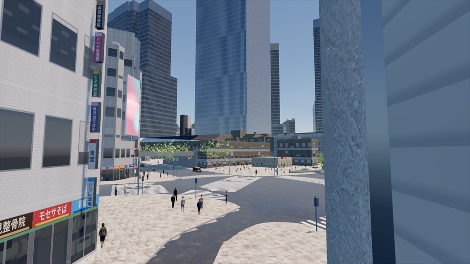<br><sub><b>시부야 스크램블 교차로</b> — 신호 현시에 맞춰 군중이 대각으로 건넌다</sub></td>
    <td width="50%">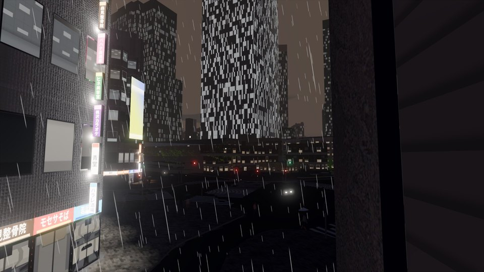<br><sub><b>비 오는 밤</b> — 창 점등 스케줄, 가상 간판, 젖은 노면</sub></td>
  </tr>
  <tr>
    <td>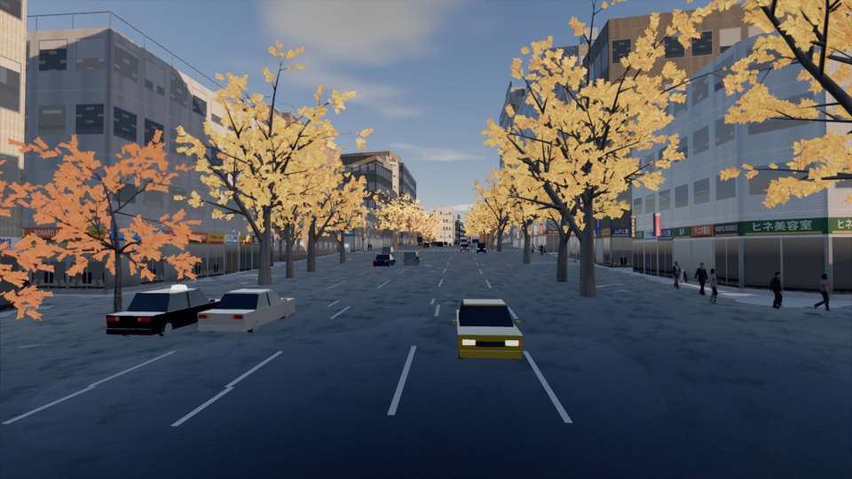<br><sub><b>오모테산도 느티나무 길</b> — 계절별 가로수 색과 교통</sub></td>
    <td>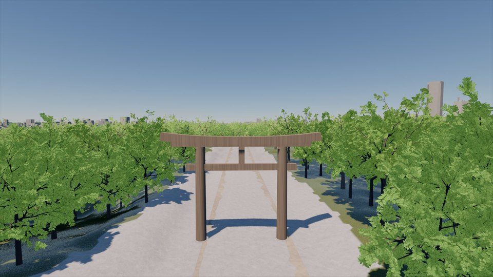<br><sub><b>메이지 신궁 大鳥居</b> — 랜드마크 오버라이드와 절차 생성 수목</sub></td>
  </tr>
  <tr>
    <td>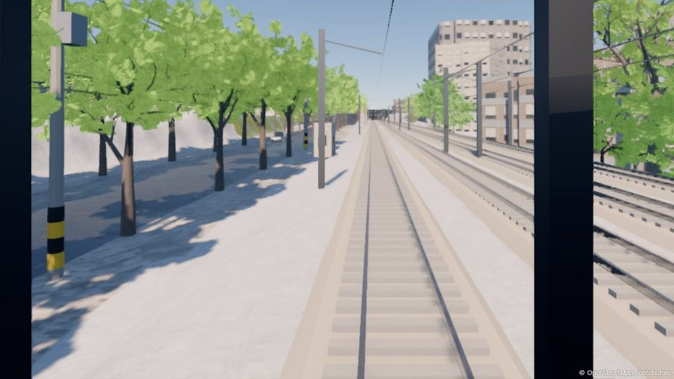<br><sub><b>야마노테선 전면 전망</b> — 시부야 → 하라주쿠 구간 주행 중</sub></td>
    <td>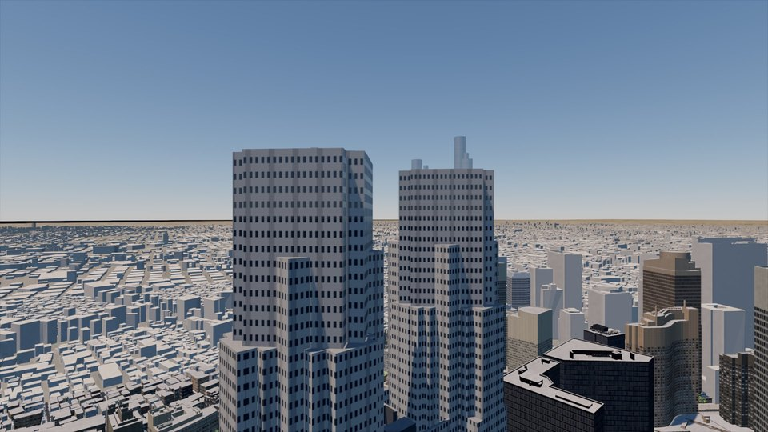<br><sub><b>도쿄도청 쌍탑</b> — 23구 원경 HLOD와 공중원근</sub></td>
  </tr>
  <tr>
    <td>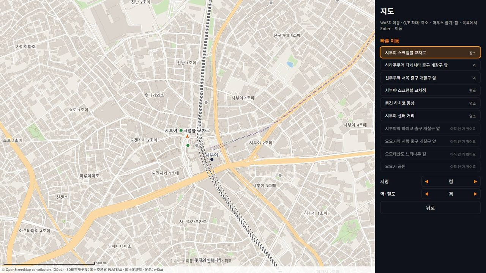<br><sub><b>지도와 빠른 이동</b> — OSM 기반 PMTiles, e-Stat 지명</sub></td>
    <td>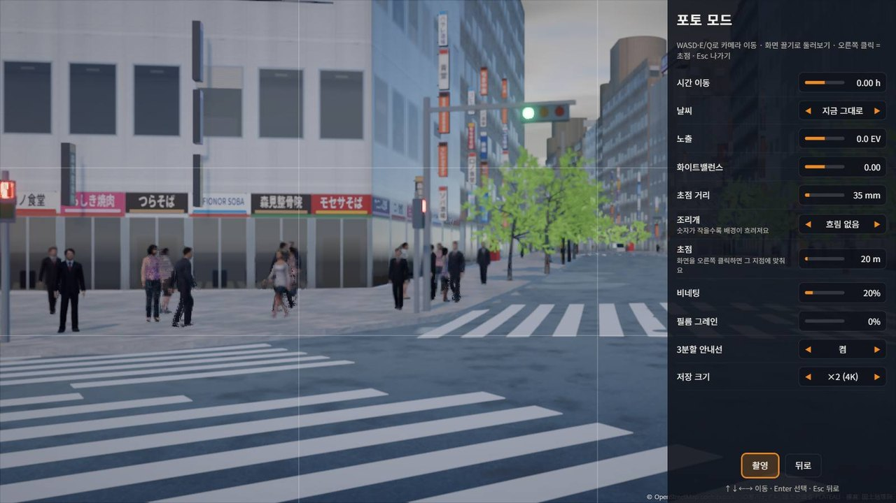<br><sub><b>포토 모드</b> — 시간·날씨·노출·렌즈·피사계 심도</sub></td>
  </tr>
</table>

<details>
<summary>타이틀 화면 (한국어)</summary>
<br>
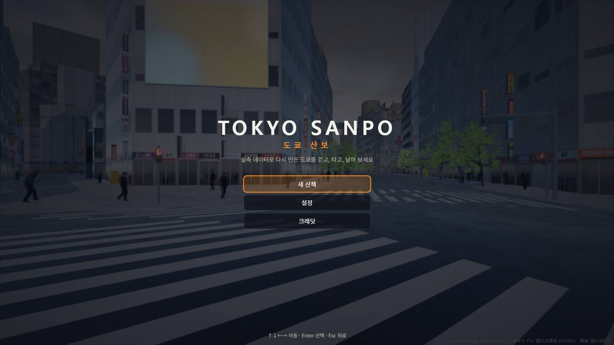
</details>

마일스톤별 골든뷰·검증 스크린샷은 [`docs/screenshots/`](docs/screenshots/)에 있습니다.

---

## 아키텍처

오프라인 파이프라인이 원천 데이터를 **TKC 셀 컨테이너**로 굽고, Cloudflare R2에 빌드 단위로 올립니다. 브라우저는 플레이어 주변 셀만 스트리밍하며, 무거운 작업(디코드·물리·군중/교통)은 전부 워커에서 돌립니다.

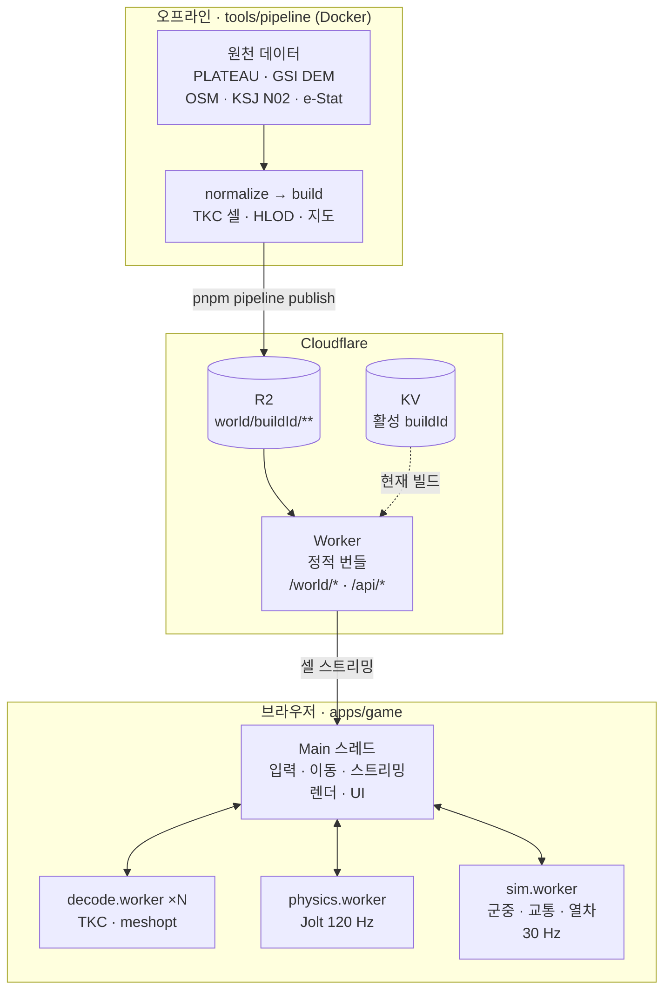

| 원칙 | 내용 |
|---|---|
| **패키지 경계** | 다른 패키지는 `@sanpo/<pkg>` 인덱스로만 import, 공개 계약은 각 패키지 `src/api.ts`에만. `dependency-cruiser`가 CI에서 강제 |
| **레이어** | L0 `core` → L1 `geo`·`tile-format` → L2 `input`·`streaming`·`physics`·`audio` → L3 `render`·`sim`·`traversal` → L4 `ui` → L5 `apps/game`(조립만). 같은 레이어·역방향 import 금지 ([01 §4](docs/01-architecture.md)) |
| **좌표계** | 월드 좌표는 항상 WF(미터, +X 동 · +Y 위 · −Z 북). 위경도 ↔ WF 변환은 `@sanpo/geo`만 수행 |
| **메인 스레드 보호** | 파싱·디코딩·물리·군중은 워커에서. SharedArrayBuffer를 위해 COOP/COEP로 `crossOriginIsolated` 확보 |
| **결정론** | 절차적 배치·NPC는 `createRng(hash32(WORLD_SEED, cellId, layer, index))` 기반 — `Math.random()` 금지 |
| **재현 가능한 데이터** | 원천은 커밋하지 않고 `data/sources.lock.json`(URL·sha256)으로 고정, 파이프라인은 Docker 이미지에서 실행 |

자세한 내용: [01-architecture](docs/01-architecture.md) · [05-tile-format](docs/05-tile-format.md) · [06-world-streaming](docs/06-world-streaming.md) · 모듈 카드 [`docs/modules/`](docs/modules/)

---

## 기술 스택

버전은 [`docs/02-tech-stack.md`](docs/02-tech-stack.md)에 정확히 고정되어 있습니다(`^` 없음, 한 번에 한 패키지씩 업그레이드).

| 영역 | 선택 | 버전 |
|---|---|---|
| 렌더러 | three.js `WebGPURenderer` + TSL (WebGL2 자동 폴백) | 0.186.1 |
| 대기·하늘 | `@takram/three-atmosphere` (Bruneton 대기 산란) | 0.19.1 |
| 물리 | Jolt Physics (`jolt-physics`, WASM 멀티스레드, Web Worker) | 1.1.0 |
| 군중·내비 | `@recast-navigation/core` (Detour NavMesh + DetourCrowd) | 0.43.1 |
| 메시·텍스처 | `meshoptimizer`, KTX2(Basis) | 1.3.0 |
| UI | Preact + `@preact/signals` | 10.29.8 / 2.11.2 |
| 언어·빌드 | TypeScript · Vite · pnpm workspaces | 6.0.3 · 8.3.5 · 10.34.5 |
| 품질 | Biome · dependency-cruiser · Vitest · Playwright | 2.5.14 · 18.4.0 · 5.0.5 · 1.63.0 |
| 인프라 | Cloudflare Workers + R2 + KV, `wrangler` | 4.153.0 |
| 파이프라인 | Node 24 컨테이너, GDAL 3.13.3, osmium-tool, `saxes`(CityGML), `@gltf-transform`, KTX-Software `toktx` | [02 §3](docs/02-tech-stack.md) |

채택하지 않은 대안(Babylon.js, Rapier, Google Photorealistic 3D Tiles, OGC 3D Tiles 등)과 이유는 [02 §5](docs/02-tech-stack.md)와 ADR에 있습니다.

---

## 데이터 출처와 라이선스

이 프로젝트의 **코드는 MIT**이고, 데이터·에셋은 각자의 라이선스를 따릅니다. 정본은 [`docs/03-data-sources.md`](docs/03-data-sources.md)와 [`content/ATTRIBUTION.json`](content/ATTRIBUTION.json)이며, 게임 크레딧 화면은 같은 파일에서 생성됩니다.

| 데이터 | 제공 | 게임에서 쓰는 곳 | 라이선스 |
|---|---|---|---|
| 3D 도시모델 (시부야·신주쿠·메구로구 2025년도판, 도쿄 23구 2020년도판) | 국토교통성 Project PLATEAU | 건물·도로·교량·도시설비, 23구 원경 | PLATEAU 사이트 폴리시 (CC BY 4.0 호환) |
| 기반지도정보 수치표고모델 1 m / 5 m | 국토지리원 | 지형 높이장·물리 | 국토지리원 콘텐츠 이용규약 (CC BY 4.0 호환) — 🔶 아래 참고 |
| 지리원 타일 (표고 타일 / 전국최신사진) | 국토지리원 | 원경 지형 / 횡단보도 위치 검증(사진은 배포 안 함) | 국토지리원 콘텐츠 이용규약 |
| OpenStreetMap (Geofabrik 간토 추출본) | OSM 기여자 | 도로 속성·신호·철도·가로수·공원·지도 | **ODbL 1.0** — 파생 DB 공개 |
| 국토수치정보 철도 데이터 (N02, 2025년도판) | 국토교통성 | 노선 식별·역 위치 | CC BY 4.0 |
| 국세조사 소지역 경계 2020 | e-Stat | HUD·지도 지명 | 정부표준이용규약 (CC BY 4.0 호환) |
| 우편번호 데이터 | 일본우편 | 지명 읽기(로마자·한글 표기 생성) | 저작권 주장 없음·자유 배포 |
| Wikidata 20개 항목 | Wikidata | 명소 이름·좌표 (설명문은 자체 작성) | CC0 1.0 |
| PBR 머티리얼 32종 / 현장 녹음 22개 | ambientCG / Freesound | 노면·외벽 재질 / 앰비언스·발소리 | CC0 |
| 아바타 / 나무 생성기 / UI·간판 글꼴 | Microsoft Rocketbox / ez-tree / Noto Sans JP·KR | 플레이어·군중 / 가로수 / UI·가상 간판 | MIT / MIT / SIL OFL 1.1 |

- **🔶 국토지리원 측량법 제30조 사용 승인**: DEM을 3D 지형으로 가공해 공개하는 경우에 해당해 승인 신청이 필요하며, **현재 신청 대기 중**입니다. 승인번호를 받으면 크레딧과 화면 표기에 추가합니다([03 §6.1](docs/03-data-sources.md)).
- **철도 운행**: JR 야마노테·사이쿄·쇼난신주쿠라인은 **자체 합성 근사 시간표**입니다(실제 시간표 아님 — JR동일본 ODPT 데이터는 상시 서비스 사용 불가 라이선스라 쓰지 않습니다). 도쿄메트로 긴자선 시간표(ODPT)는 개발자 키 대기로 아직 수록되지 않았습니다.
- **ODbL 준수**: 빌드에 쓴 OSM 파생 DB를 `/world/<buildId>/global/odbl/`로 공개하고 크레딧 화면 맨 위에 링크합니다.
- **상표·저작물**: 간판은 생성 규칙으로 만든 가상 브랜드(실존 상호 목록과 대조 0건, CI 상표 스캔), 차량·열차·소품은 로고·엠블럼·번호판 없는 절차 모델입니다. 실제 발차 멜로디·점포 징글·안내방송은 쓰지 않습니다.
- 실시간 날씨(Open-Meteo)는 production에서 꺼져 있습니다(호출 0).

게임 화면 오른쪽 아래 상시 표기:

```
© OpenStreetMap contributors · 3D都市モデル: 国土交通省 PLATEAU · 標高: 国土地理院
```

---

## 빠른 시작

**요구 사항**: Node.js 24 LTS(`.nvmrc`, 하한 22.12 — [ADR-0011](docs/adr/0011-node-22-baseline.md)), pnpm 10.34.5(`packageManager` 고정, `corepack enable`), WebGPU를 지원하는 데스크톱 브라우저 권장.

```bash
pnpm i
```

```bash
pnpm dev
```

`pnpm dev`는 게임(Vite)과 Worker(`wrangler dev`, 로컬 R2)를 함께 띄웁니다. 전체 월드 데이터 없이 바로 보려면 저장소에 포함된 소형 픽스처(스크램블 교차로 주변 L0 셀 4개)를 쓰세요: `http://localhost:5173/?world=mini`

| 명령 | 하는 일 |
|---|---|
| `pnpm check` | Biome + `tsc`(브라우저·Node 두 tsconfig) + dependency-cruiser + 파일 크기 검사 |
| `pnpm test` | Vitest 단위·통합 테스트 |
| `pnpm build` | 게임 `vite build` + Worker dry-run 번들 |
| `pnpm test:e2e` | Playwright 부트·렌더·물리·UI 스모크(`?world=mini`) |
| `pnpm golden` / `pnpm perf` | 실제 GPU Chrome 골든뷰 캡처 / 성능 측정 (로컬 전용) |
| `pnpm pipeline <cmd>` | 데이터 파이프라인 (`fetch` · `normalize` · `build` · `validate` · `publish` …) |
| `pnpm codemap` | [`docs/generated/CODEMAP.md`](docs/generated/CODEMAP.md) 재생성 |

**월드 소스 전환**: `?world=mini`(픽스처) · `?world=local`(로컬 파이프라인 빌드 `data/build/`) · 기본값(Worker `/api/world/current` → R2). 전체 월드 빌드는 원천 데이터와 Docker가 필요합니다 — [04-data-pipeline](docs/04-data-pipeline.md).

<details>
<summary>기본 조작 (설정에서 재바인딩 가능)</summary>

| 동작 | 키보드·마우스 | 게임패드 |
|---|---|---|
| 이동 / 둘러보기 | WASD / 마우스 | L스틱 / R스틱 |
| 달리기 · 걸음 단계 | Shift · X | L3 · 스틱 기울기 |
| 상호작용(탑승·하차·개찰) | F | X(□) |
| 시점 전환 | V | R3 |
| 자유 비행 · 상승/하강 · 착지 | C · E/Q · G | Select+Y · RB/LB · A |
| 지도 · 포토 모드 · 일시정지 | M · P · Esc | Select · Start+Y · Start |
| 운전: 가속/브레이크 · 핸드브레이크 · 등화/방향지시 | W/S · Space · L, Q/E | RT/LT · A · D-pad |

</details>

---

## 저장소 구조

```
apps/game            브라우저 클라이언트(Vite) — 조립(Composition Root)만 담당
apps/worker          Cloudflare Worker — 정적 에셋 + R2 월드 데이터 + API
packages/core        공통 타입, 이벤트 버스, 로거, rng, 설정, 수학
packages/geo         좌표 변환(EPSG:6668/6677 ↔ WF), 셀 인덱싱
packages/tile-format TKC 셀 컨테이너 인코더/디코더(파이프라인·런타임 공용)
packages/streaming   셀 로딩/언로딩, 우선순위, 캐시, 디코드 워커
packages/render      WebGPU 렌더러, TSL 머티리얼, 조명, 대기, 포스트
packages/physics     Jolt 워커 호스트 + 워커, 캐릭터/차량/자전거
packages/input       액션 맵(키보드·마우스·게임패드)
packages/traversal   이동 모드 상태기계 + 카메라 리그
packages/sim         시계, 날씨, 군중, 교통, 열차
packages/audio       WebAudio 앰비언스·3D 사운드·합성음
packages/ui          Preact HUD·메뉴·지도·포토 모드
tools/pipeline       데이터 빌드 CLI(Node + 외부 바이너리, Docker)
tools/codemap        CODEMAP.md 생성기
content/             수작업 원본(랜드마크 오버라이드, 소품, 머티리얼, 가상 브랜드, 출처 표기)
schemas/             파이프라인 ↔ 런타임 데이터 계약(JSON Schema)
docs/                설계 문서·ADR·모듈 카드·로드맵·스크린샷
```

---

## 문서 지도

설계는 문서 우선으로 진행합니다. 사람과 AI 세션 모두 [`CLAUDE.md`](CLAUDE.md)(규칙·문서 지도) → [`PROGRESS.md`](PROGRESS.md)(현재 상태·알려진 이슈) 순으로 시작합니다.

| 문서 | 내용 | 문서 | 내용 |
|---|---|---|---|
| [00 Vision](docs/00-vision.md) | 비전·필러·비목표·MVP 범위 | [09 Traversal](docs/09-traversal.md) | 이동 모드 상태기계·입력·카메라 |
| [01 Architecture](docs/01-architecture.md) | 구조·스레드·의존 규칙·좌표계 | [10 Simulation](docs/10-simulation.md) | 시계·날씨·군중·교통·열차 |
| [02 Tech Stack](docs/02-tech-stack.md) | 고정 버전과 선택 근거 | [11 Audio](docs/11-audio.md) | 사운드 구조와 라이선스 규칙 |
| [03 Data Sources](docs/03-data-sources.md) | 데이터 출처·라이선스·감사 결과 | [12 UI/UX](docs/12-ui-ux.md) | HUD·지도·포토 모드·세이브·i18n |
| [04 Data Pipeline](docs/04-data-pipeline.md) | 원천 → 정규화 → 셀 빌드 | [13 Deployment](docs/13-deployment.md) | Worker·R2·헤더·CI/CD·비용 |
| [05 Tile Format](docs/05-tile-format.md) | TKC 셀 컨테이너 바이너리 스펙 | [14 Testing & Perf](docs/14-testing-perf.md) | 테스트 전략·성능 예산·골든뷰 |
| [06 World Streaming](docs/06-world-streaming.md) | 그리드·HLOD·우선순위·캐시 | [15 Conventions](docs/15-conventions.md) | 코딩 규칙·파일 크기·커밋 |
| [07 Rendering](docs/07-rendering.md) | 렌더러·대기·머티리얼·품질 티어 | [16 Context Protocol](docs/16-context-protocol.md) | 문서·컨텍스트 관리 규칙 |
| [08 Physics](docs/08-physics.md) | Jolt 워커·캐릭터·차량·자전거 | [17 Roadmap](docs/17-roadmap.md) | 마일스톤 M00–M11 인덱스 |

- **설계 결정 기록(ADR)**: [`docs/adr/`](docs/adr/) — 0001(three.js WebGPU 채택)부터 0105까지 105건
- **모듈 카드**: [`docs/modules/`](docs/modules/) — 패키지별 공개 API·불변식
- **로드맵 태스크**: [`docs/roadmap/`](docs/roadmap/) · **용어집**: [`docs/glossary.md`](docs/glossary.md) · **데이터 계약**: [`schemas/`](schemas/)

---

## 보안과 비용 안전장치

공개 서비스이므로 보안과 클라우드 비용 모두에 방어선을 둡니다. 2026-10 외부 보안 점검의 8개 발견 사항(F01–F08)은 production에서 모두 해결을 확인했습니다 — [재검증 기록](docs/security/2026-10-security-followup.md), [ADR-0103](docs/adr/0103-security-followup-worker-guards.md).

**보안**
- 엄격한 응답 헤더: COOP/COEP/CORP, CSP(`frame-ancestors 'none'`, 외부 도메인 리소스 없음 — 폰트까지 자체 호스팅), `X-Frame-Options: DENY`, Referrer-/Permissions-Policy, HTTPS 전용(HSTS·TLS 1.2+는 존 설정) — [13 §3](docs/13-deployment.md)
- Worker 입력 검증: 오류 보고 `/api/log`의 Origin 허용 목록·Content-Type·4096 B 상한·IP 해시 기반 속도 제한, 월드 경로의 예상 밖 쿼리 거절, 404 네거티브 캐시, 잘못된 Range 416
- 개인정보 최소화: 오류 보고는 세션 샘플링, 이메일·URL·긴 숫자 제거, IP·UA·위치 미수집
- 공급망: 모든 GitHub Actions 커밋 SHA 고정, Dependabot(7일 cooldown), CI `security` 잡(gitleaks 전체 이력 + `pnpm audit`), production 빌드에서 진단 도구 제거, production `workers.dev`·프리뷰 비활성
- 배포: `main` 병합 → staging 자동 배포·스모크 → Environment `production` **수동 승인** → production. 최신 `main`만 승인 대상

**비용 회로 차단기 (킬 스위치)** — [13 §6.1](docs/13-deployment.md), [ADR-0104](docs/adr/0104-cost-circuit-breaker.md)
- `usage.yml`이 30분마다 Cloudflare 사용량을 점검해 이 프로젝트 지표 90 % 초과 또는 계정 예상 추가 요금 $1 초과 시 이슈를 열고 존 WAF 규칙을 켭니다.
- 차단 범위는 `/world/*`·`/api/*`뿐 — 정적 게임 파일은 계속 제공되어 플레이어에게 "점검 중" 화면을 보여 줍니다. 수동 조작: `pnpm killswitch status | on | off`
- 실시간 과금 상한은 아닙니다(예약 실행·집계 지연이 있음). 한계는 [13 §6.1](docs/13-deployment.md)에 적혀 있습니다.

---

## 품질 게이트

| 게이트 | 내용 |
|---|---|
| **CI** (`ci.yml`, PR·main) | Node 24·22 매트릭스 `pnpm check` → `pnpm test` → `pnpm build` → 에셋 크기 검사, Playwright e2e(WebGL2 부트 스모크), 기록 누락 검사(CODEMAP·모듈 카드), 보안 잡 |
| **PR 프리뷰** (`preview.yml`) | staging Worker에 버전 업로드 → PR 코멘트로 프리뷰 URL |
| **골든뷰** | `tests/golden/views.json`의 고정 시점 25개를 실제 GPU Chrome으로 캡처, SSIM으로 회귀 비교 |
| **성능** | 예산 표([14 §2](docs/14-testing-perf.md)) 대비 자동 측정 → [`docs/generated/perf-latest.md`](docs/generated/perf-latest.md). 기준 노트북 GPU에서 프레임·메인 스레드·초기 다운로드 일부 항목이 아직 예산을 넘어 개선 중입니다 |
| **소크** | 도보 → 열차 → 주행 → 비행 반복 1시간(메모리 누수 점검, [ADR-0101](docs/adr/0101-soak.md)) |
| **크기 규칙** | 소스 파일 ≤ 400줄 · 함수 ≤ 60줄 · 문서 ≤ 400줄 (`scripts/check-size.ts`) |

알려진 이슈와 다음 작업은 [`PROGRESS.md`](PROGRESS.md)에 정리되어 있습니다.

---

## 기여하기

1. 코드 작성 전에 [`docs/15-conventions.md`](docs/15-conventions.md)(코딩 규칙·파일 크기·네이밍·에러 처리)를 읽어 주세요.
2. 작업은 로드맵 태스크 단위입니다. 태스크 블록(`docs/roadmap/MNN.md`)의 `Read:`·`Files:`·`Accept:`를 따릅니다.
3. 커밋은 Conventional Commits + 태스크 ID: `feat(render): M03-T04 facade shader`. 한 PR = 한 태스크.
4. 공개 API를 바꾸면 같은 커밋에서 모듈 카드(`docs/modules/<pkg>.md`)를, 설계 결정이 생기면 ADR을 추가하고 `pnpm codemap`을 실행합니다.
5. 새 데이터·에셋·사운드는 [`docs/03-data-sources.md`](docs/03-data-sources.md) 표와 [`content/ATTRIBUTION.json`](content/ATTRIBUTION.json)을 같은 커밋에서 갱신합니다. 출처 불명 에셋, 실제 상표 로고, 발차 멜로디, 점포 징글은 받지 않습니다.
6. PR 전에 `pnpm check`와 `pnpm test`를 통과시켜 주세요.

---

## 라이선스와 크레딧

- **코드**: [MIT License](LICENSE) © 2026 Sunwoong Kim
- **데이터·에셋**: 각 원천의 라이선스를 따릅니다. 아래는 주요 데이터 출처 표기이며, 전체 목록(머티리얼·음원·글꼴·캐릭터 포함)은 정본 파일에 있습니다 — [`docs/03-data-sources.md`](docs/03-data-sources.md), [`content/ATTRIBUTION.json`](content/ATTRIBUTION.json). 게임 안 크레딧 화면과 `/oss-licenses.txt`(npm 의존성 라이선스 원문)에서도 볼 수 있습니다.

```
© OpenStreetMap contributors
出典：国土交通省 Project PLATEAU 3D都市モデル（渋谷区）を加工して作成
出典：国土交通省 Project PLATEAU 3D都市モデル（新宿区）を加工して作成
出典：国土交通省 Project PLATEAU 3D都市モデル（目黒区）を加工して作成
出典：国土交通省 Project PLATEAU 3D都市モデル（東京都23区）を加工して作成
出典：国土地理院（基盤地図情報 数値標高モデル）を加工して作成
出典：国土地理院（地理院タイル 標高タイル）を加工して作成
出典：国土数値情報（鉄道データ）（国土交通省）を加工して作成
出典：政府統計の総合窓口(e-Stat)（国勢調査 小地域境界データ）を加工して作成
```

이 프로젝트는 국토교통성·국토지리원·OpenStreetMap 재단 및 각 철도 사업자와 관계가 없으며, 이들이 보증하거나 제작한 것이 아닙니다.
